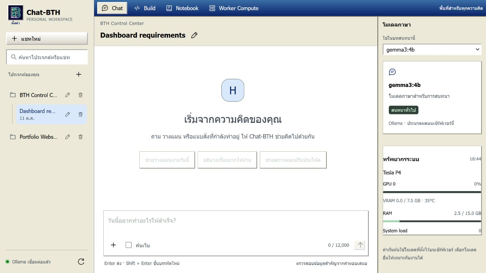
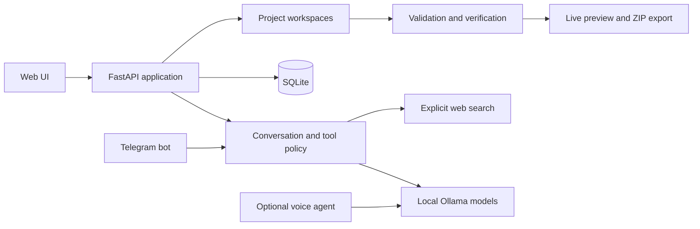

# Chat-BTH

Local-first AI agent workspace with Ollama, Telegram, guided web generation and verification.

Chat-BTH คือผู้ช่วย AI ที่รันบนเครื่องของผู้ใช้เป็นหลัก มี Web UI สำหรับแชทและสร้างเว็บไซต์/แดชบอร์ด, Telegram bot สำหรับใช้งานจากมือถือ และ workflow ที่ตรวจสอบไฟล์ ผลการทดสอบ และหลักฐานก่อนส่งออก

## Portfolio snapshot

### ค่าจาก repository

- โมเดลเริ่มต้น: `gemma3:4b`
- Context เริ่มต้น: 8,192 tokens เพื่อให้ clone แล้วเริ่มได้บนเครื่องทั่วไป
- Web bind: `127.0.0.1:8080`
- Command execution: ปิดไว้จนกว่าจะตั้ง `HERMES_ENABLE_COMMANDS=true`
- หาก bind นอก loopback ระบบจะไม่เริ่มจนกว่าจะตั้ง `HERMES_WEB_TOKEN`

### ค่าบนเครื่อง Dell ที่ตรวจพบเมื่อ 11 ตุลาคม 2026

- โมเดล runtime: `deepseek-r1:7b-40k`
- Context: 40,960 tokens, `NUM_THREAD=4`, `NUM_GPU=999`
- Web bind: `0.0.0.0:8080`
- ค่าบน Dell เป็น deployment override ใน `.env` และไม่ใช่ค่า default ของ repository
- Secret, database, log และ runtime workspace ไม่ถูก commit

## ความสามารถปัจจุบัน

### Web UI

- **Chat** — สร้างโปรเจกต์และแชทหลายรายการ เปลี่ยนชื่อ ลบ เลือกโมเดล แนบไฟล์ข้อความ และค้นเว็บเมื่อเปิด “ค้นเว็บ”
- **Build** — เปิด/สร้างไฟล์ใน workspace, ให้ AI วิเคราะห์และแก้ไฟล์, รันคำสั่งที่อนุญาต, ตรวจ HTML/CSS/JavaScript และเปิด Live Preview
- **Build Assistant** — คุยเพื่อวางแผนหรือขอคำแนะนำก่อนให้ AI แก้ไฟล์จริง
- **Guided Build (BTH Create)** — ตอบคำถามทีละข้อ ตรวจ Project Spec, Freeze ข้อกำหนด, วิเคราะห์ส่วนที่ขาด, สร้างงานตามลำดับ และ Verification
- **Preview Editor** — เลือก Element ใน Preview แล้วแก้ข้อความ ลิงก์ รูปภาพ และ style ที่รองรับ โดยต้องอนุมัติ patch ก่อนใช้
- **ประวัติไฟล์** — revision, undo, redo, restore และ compare
- **ตรวจสอบ/ส่งออก** — diagnostics, security audit, audit log, metrics, รายงาน Build และ export เว็บไซต์เป็น ZIP
- **Notebook** — สร้าง ค้นหา แก้ไข ลบ และส่งออกเป็น .txt เก็บข้อมูลใน localStorage ของเบราว์เซอร์
- **Worker Compute** — ดูสถานะ Ollama, GPU, RAM และ system load; บันทึกรายชื่อเครื่องใน LAN และเพิ่ม provider แบบ OpenAI-compatible หรือ Google AI Studio
- **สร้างเสียง** — สร้าง MP3 จากคำตอบด้วย Piper และ FFmpeg บนเครื่อง (ไม่ส่งข้อความออกอินเทอร์เน็ต)
- **ธีม Web UI** — Windows XP, Light, Neon, macOS, Cyberpunk, Synthwave, Blueprint, Dracula, Matrix, Win98 และ E-Ink

### ประเภทงานที่ Guided Build รองรับ

- Internal Dashboard
- เว็บไซต์หลายหน้า: Corporate Website, Organization Portal, Retail & Product Catalog, Service Business, Knowledge & Document Hub
- เว็บไซต์มาตรฐาน: Landing Page, Company Website, Portfolio, Product Catalog, Content / Blog
- Catalog / Library: Digital Library, Document Center, Product & Service Catalog, Media Archive, Learning Library

เว็บไซต์กำหนดหน้าได้ เช่น หน้าหลัก เกี่ยวกับองค์กร นโยบาย กฎระเบียบ/เอกสาร คลังความรู้ สินค้า บริการ ข่าวสาร ติดต่อ และเนื้อหาทั่วไป ระบบจะสร้าง HTML, CSS, JavaScript และเมนูเชื่อมโยงให้

### Telegram bot

- ตอบคำถามจาก Ollama
- /search <คำถาม> ค้นเว็บก่อนตอบ
- สรุป YouTube จากชื่อและ transcript หากวิดีโอมีคำบรรยาย
- /run <ไฟล์.py> ขออนุมัติรันไฟล์ Python ภายใน experiments/
- /improve <คำขอ> สร้างแผนปรับปรุงโดยยังไม่แก้ไฟล์จริง
- จำกัดผู้ใช้ด้วย MY_USER_ID และต้องกดอนุมัติก่อนรันสคริปต์

## Architecture

ขอบเขตถูกแยกเป็น Web/Telegram adapters, model orchestration, persistence, workspace generation และ verification เพื่อให้ทดสอบแต่ละส่วนได้โดยไม่ต้องเรียกโมเดลจริง

## ติดตั้ง

ต้องมี Python 3.10 ขึ้นไป, Ollama ที่กำลังทำงาน และโมเดลอย่างน้อยหนึ่งตัว

    python -m venv venv
    ./venv/bin/pip install -r requirements.txt
    cp .env.example .env
    ollama pull gemma3:4b

ปรับ `.env` เฉพาะค่าที่ต้องการ ค่าเริ่มต้นตรงกับ `bot.py`, `Modelfile` และตาราง Configuration ด้านล่าง:

    OLLAMA_URL=http://127.0.0.1:11434/api/generate
    MODEL_NAME=gemma3:4b
    WEB_HOST=127.0.0.1
    WEB_PORT=8080
    HERMES_ENABLE_COMMANDS=false

### เตรียมเสียงแบบ local

Voice Agent เป็น optional dependency และไม่ถูกรวมใน CI หลัก:

    ./venv/bin/pip install -r requirements-voice.txt

ต้องมี `ffmpeg` ใน `PATH` และไฟล์โมเดล Piper ภาษาไทยพร้อมไฟล์ config `.onnx.json` จากนั้นตั้ง `HERMES_PIPER_MODEL_TH` ใน `.env` ระบบจะเรียก `python -m piper` จาก virtual environment เดียวกับ Web UI

การดาวน์โหลดโมเดลอาจทำครั้งเดียวบนเครื่องที่เชื่อมต่ออินเทอร์เน็ต แล้วคัดลอกทั้งสองไฟล์มายังเครื่องใช้งานได้ หลังจากตั้งค่าแล้ว การกดสร้างเสียงใน Web UI และ `voice_agent.py` จะเรียกเฉพาะ Piper และ FFmpeg ในเครื่อง ไม่มีการส่งข้อความไปยังบริการ TTS ภายนอก

ถ้าจะใช้ Telegram ให้เพิ่ม TELEGRAM_TOKEN และ MY_USER_ID อย่า commit .env หรือ API key

## วิธีใช้งานแบบเร็ว

### เปิด Web UI

    ollama serve
    ./venv/bin/python web_app.py

เปิด [http://127.0.0.1:8080](http://127.0.0.1:8080) ในเบราว์เซอร์ ห้ามเปิด web/index.html ด้วย file:// เพราะหน้าเว็บต้องเรียก API จาก server

1. สร้างโปรเจกต์จากเมนูด้านซ้าย
2. ใช้ Chat เพื่อสนทนา หรือ Build เพื่อสร้างงาน
3. เลือกโมเดลและพิมพ์คำสั่งให้ชัดเจน
4. เปิด “ค้นเว็บ” เมื่ออยากได้ข้อมูลปัจจุบัน
5. สร้างเว็บไซต์ด้วย Build > Guided Build ตอบคำถาม ตรวจสรุป แล้วกด Freeze & Build
6. ตรวจ Preview และใช้ Files / History / Security Audit / Export ตามต้องการ

### สร้างเว็บไซต์

ไปที่ Build > Guided Build แล้วเลือก blueprint กรอกชื่อ โทนสี และหน้า/หมวดหมู่:

1. กด “ตรวจ Project Spec”
2. แก้ข้อมูลหากระบบแจ้งว่ายังไม่ครบ
3. กด “Freeze & Build”
4. ตรวจ Verification และเปิด Preview
5. แก้ไฟล์โดยตรง หรือเลือก Element ใน Preview ให้ Build Assistant เสนอ patch
6. กด “ส่งออก ZIP” เมื่อผ่านการตรวจสอบ

Catalog/Library รองรับค้นหา เรียงลำดับ หน้าต่างรายละเอียด และฟอร์มเพิ่มรายการพร้อมปก/PDF ข้อมูลรายการเก็บใน IndexedDB ของเบราว์เซอร์ จึงเหมาะกับต้นแบบหรือเครื่องเดียว

### เปิด Telegram bot

    ollama serve
    ./venv/bin/python bot.py

พิมพ์ /start เพื่อดูคำสั่ง ข้อความปกติจะตอบจากโมเดลโดยตรง ระบบจะค้นเว็บอัตโนมัติเมื่อข้อความสื่อว่าต้องการข้อมูลล่าสุด หรือมีลิงก์ YouTube

## โมเดลและ provider

### เหตุผลที่เลือก `gemma3:4b` บน VRAM 8 GB

Repository เลือก `gemma3:4b` เป็นค่าเริ่มต้น เพราะเป็นจุดสมดุลสำหรับการ์ด VRAM 8 GB:

1. โมเดลขนาด 4B ใช้พื้นที่น้ำหนักโมเดลน้อยกว่า 7B ทำให้เหลือ VRAM สำหรับ KV cache ซึ่งเป็นส่วนสำคัญของ Context Window ขนาด 65K
2. เหมาะกับงานสนทนา ภาษาไทย และงานสรุป/วิเคราะห์บนเครื่องภายใน
3. สามารถเพิ่ม context ได้ตาม KV cache และหน่วยความจำของ host โดยไม่ผูกค่า tuning ของ Dell เข้ากับ source code

ค่า default ใน repo คือ 8K เพื่อให้เริ่มใช้งานได้ปลอดภัย ส่วน 65K เป็น tuned profile ที่ต้องทดสอบบน host จริง ไม่ใช่คำรับประกันว่าจะอยู่ใน VRAM ทั้งหมด การใช้จริงขึ้นกับ quantization, prompt, output และ KV cache ให้ตรวจ `ollama ps` และ `nvidia-smi`; หาก OOM ให้ลด context เป็น 49K, 32K หรือ 16K

ข้อจำกัดที่ต้องทราบ: `gemma3:4b` ใน Ollama ปัจจุบันไม่รองรับ Tools ผ่าน custom OpenAI-compatible endpoint จึงตั้ง `platform_toolsets.telegram: []` ไว้ เพื่อให้ Telegram ตอบข้อความได้เสถียร หากต้องการใช้ Tools ให้เลือกโมเดลที่รองรับ Tools และมี Context อย่างน้อย 64K

โมเดลเริ่มต้นมาจาก `MODEL_NAME` และ Web UI อ่านรายชื่อโมเดลจาก Ollama หากต้องการ system prompt ใน `Modelfile` ให้สร้างชื่อใหม่แล้ว override ใน `.env`:

    ollama create chat-bth -f Modelfile
    MODEL_NAME=chat-bth

เพิ่ม provider ได้จาก Worker Compute โดยต้องใช้ HTTPS API key จะอยู่ในหน่วยความจำของ Web server ไม่ส่งกลับ browser และหายเมื่อ restart server

    VISION_API_KEY=เก็บคีย์ไว้บน-server
    HERMES_PROVIDERS_JSON=[{"id":"vision","name":"Vision Worker","type":"openai-compatible","base_url":"https://provider.example/v1","api_key_env":"VISION_API_KEY","models":["vision-model"],"capabilities":["vision"]}]

Google AI Studio ใช้ native generateContent API โดยเลือกประเภท provider เป็น Google ในหน้าเว็บ

## Configuration

ตารางนี้แยกค่าใน source code ออกจาก deployment override เพื่อไม่ให้ README อ้างค่าที่ไม่ได้อยู่ใน repo:

| ตัวแปร | Repository default | Dell runtime snapshot | หน้าที่ |
| --- | --- | --- | --- |
| `OLLAMA_URL` | `http://127.0.0.1:11434/api/generate` | ค่าเดียวกัน | Ollama API |
| `MODEL_NAME` | `gemma3:4b` | `deepseek-r1:7b-40k` | โมเดลหลัก |
| `NUM_CTX` | `8192` | `40960` | Context ที่ส่งให้ Ollama |
| `NUM_THREAD` | `4` | `4` | CPU threads |
| `NUM_GPU` | `-1` (auto) | `999` | GPU layers; ต้องทดสอบบน host |
| `WEB_HOST` / `WEB_PORT` | `127.0.0.1` / `8080` | `0.0.0.0` / `8080` | Web bind |
| `HERMES_WEB_TOKEN` | ว่างได้เฉพาะ loopback | ต้องตั้งค่า | ป้องกัน HTTP/WebSocket API |
| `HERMES_ENABLE_COMMANDS` | `false` | `false` | opt-in สำหรับ subprocess |
| `HERMES_RUN_COMMANDS` | `python,python3,node,npm,pytest` | ไม่ override | allowlist หลัง opt-in |
| `HERMES_DB_PATH` | `data/chat_bth.db` | ไม่ override | SQLite |
| `HERMES_WORKSPACE_ROOT` | `data/workspaces` | ไม่ override | ไฟล์ Build |
| `TEMPERATURE` | `0.7` | ไม่ override | ความสุ่มของคำตอบ |
| `MAX_OUTPUT_TOKENS` | `512` | `256` | output budget |
| `TELEGRAM_TOKEN` / `MY_USER_ID` | ว่าง / `0` | secret / private | Telegram authentication |
| `HERMES_PIPER_MODEL_TH` | ว่าง | host-specific | โมเดลเสียงภาษาไทย |

ไฟล์ `.env.example` คือ source of truth สำหรับค่า repository; `.env` บน Dell เป็น deployment configuration และไม่อยู่ใน Git

## ข้อจำกัดและความปลอดภัย

- ไฟล์แนบรวมกับข้อความไม่เกิน 12,000 ตัวอักษร แนบได้ 5 ไฟล์ ไฟล์ละไม่เกิน 500 KB รองรับ txt, md, csv, json, py, js, ts, html, css, log
- Build จำกัดไฟล์ประมาณ 1 MB, จำนวน 500 ไฟล์ และเวลารันคำสั่ง 1–60 วินาที
- Command execution ปิดเป็นค่าเริ่มต้น ต้องตั้ง `HERMES_ENABLE_COMMANDS=true` จึงจะใช้ allowlist ได้ และยังไม่ใช่ sandbox ระดับ container
- Telegram /run อนุญาตเฉพาะ .py ใต้ experiments/ และต้องกดอนุมัติ แต่ไม่ใช่ sandbox ระดับระบบปฏิบัติการ
- Notebook และประวัติ Build Assistant เก็บใน browser ไม่ซิงก์ข้ามเครื่อง/พอร์ต ควร export ข้อมูลสำคัญ
- Project, chat และข้อความอยู่ใน SQLite; ไฟล์ Build แยกตาม project id และการลบโปรเจกต์จะลบ workspace ด้วย
- Preview ต้องมี entry เป็น index.html, dist/index.html, build/index.html หรือ public/index.html และควรใช้ asset แบบ relative path
- เมื่อ `WEB_HOST` ไม่ใช่ loopback ระบบบังคับ `HERMES_WEB_TOKEN`; ใช้ HTTPS ผ่าน reverse proxy และ firewall และไม่ควรเปิดสู่ Internet โดยตรง
- Audit log redaction ทำงานแบบ recursive กับ key ที่เป็น token, password, secret, API key, authorization และ cookie พร้อมจำกัดขนาดโดยยังเก็บ JSON ที่อ่านได้

## ตรวจสอบและทดสอบ

    python -m compileall -q bot.py web_app.py web_store.py bth_create tests
    node --check web/app.js
    ./venv/bin/python -m unittest discover -s tests -v
    ./venv/bin/python -m tests.preview_fixture

ผลล่าสุดบน Dell: Python compile ผ่าน, `node --check` ผ่าน และ automated tests ผ่าน 135/135 รายการ GitHub Actions รัน checks ชุดเดียวกันทุก push และ pull request ส่วน Voice Agent แยกออกจาก CI หลักเพราะต้องใช้ native audio/GPU dependencies

## โครงสร้างโปรเจกต์

    web_app.py             FastAPI backend, Web UI และ API
    web/                   HTML, CSS, JavaScript และ assets
    bot.py                 Telegram bot, Ollama, web search และ YouTube
    voice_agent.py         Voice agent แบบ local Whisper + Piper + pygame (optional)
    web_store.py           SQLite persistence
    bth_create/            Blueprint, component, theme, guided build, verification
    data/workspaces/       ไฟล์ Build แยกตาม project id
    data/chat_bth.db       SQLite database เริ่มต้น
    data/audio/            MP3 จาก endpoint เสียง
    experiments/           สคริปต์ที่ Telegram /run อนุญาต
    tests/                 regression tests และ UI fixture
    Modelfile              สูตรสร้างโมเดล chat-bth จาก gemma3:4b
    requirements.txt       Pinned Web/Telegram dependencies
    requirements-voice.txt Optional voice dependencies

voice_agent.py เป็นโปรแกรมแยกจาก Web UI ต้องติดตั้ง dependency เพิ่ม เช่น SpeechRecognition, faster-whisper และ pygame รวมถึงมีไมโครโฟน/อุปกรณ์เสียง จึงไม่ได้อยู่ในขั้นตอนเริ่มต้นของ Web UI

เมื่อเปิด Voice Agent ให้กด `5` และ `6` พร้อมกันเพื่อเริ่มบันทึกหนึ่งประโยค (Push-to-Talk) ปรับปุ่มได้ผ่าน `HERMES_PUSH_TO_TALK_KEYS` เช่น `F8` หรือ `ctrl+space` โดยการดักปุ่มระดับระบบต้องทำงานบน desktop session ที่อนุญาตให้โปรแกรมรับ global keyboard events.

## Example generated output

Guided Build เปลี่ยนคำตอบจาก form เป็น Project Spec ที่ตรวจ schema แล้ว จากนั้น freeze ข้อกำหนด สร้าง task DAG, generate workspace และรัน verification ก่อนเปิด Preview ตัวอย่างผลลัพธ์และ acceptance checks อยู่ใน [`docs/EXAMPLE_OUTPUT.md`](docs/EXAMPLE_OUTPUT.md)

## My role

- กำหนด product requirements และ workflow ของ Local AI workspace
- ออกแบบ security boundary สำหรับ token, workspace path, command allowlist และ approval
- พัฒนา Web/Telegram adapters, persistence, guided generation และ verification pipeline
- สร้าง regression tests และ deployment บนเครื่อง Dell ภายในเครือข่าย
- ใช้ AI-assisted development เพื่อเร่ง implementation โดยตรวจผลด้วย source review และ automated tests

## Challenges

- ทำให้โมเดล local ที่มีข้อจำกัดด้าน VRAM สร้าง structured output ได้เสถียร
- ป้องกัน path traversal และ command execution โดยไม่ทำลาย workflow การสร้างโปรเจกต์
- รักษาประวัติ workspace, audit evidence และผลการตรวจสอบระหว่างการแก้หลายรอบ
- แยกค่าที่ portable ใน repository ออกจาก tuning และ secrets ของเครื่องจริง

## Results

- มี workflow ตั้งแต่รับ requirement, freeze spec, generate, verify, preview จน export
- รองรับการแชทและ build ผ่าน Web UI พร้อม Telegram integration
- มี automated regression suite, CI, pinned dependencies และ Dependabot
- ทำงานแบบ local-first; ข้อมูลแชทและ workspace อยู่ใน SQLite/ไฟล์ภายในเครื่อง

## Limitations

- Process limits และ allowlist ไม่เท่ากับ container sandbox
- SQLite เหมาะกับ single-host deployment มากกว่าการเขียนพร้อมกันหลายเครื่อง
- คุณภาพและความเร็วขึ้นกับโมเดล, quantization, context และ hardware
- Voice Agent ต้องติดตั้ง native dependencies และทดสอบกับอุปกรณ์จริงแยกจาก CI
- Runtime Dell อาจ override ค่าใน repo; ต้องตรวจ deployment snapshot ก่อนวิเคราะห์ performance
